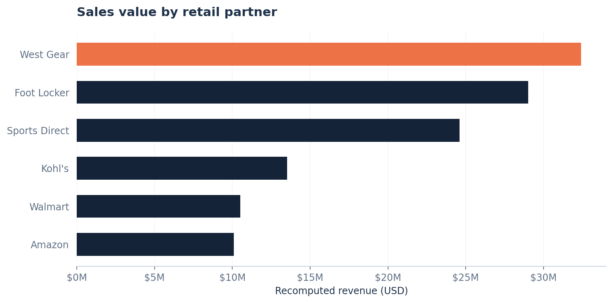
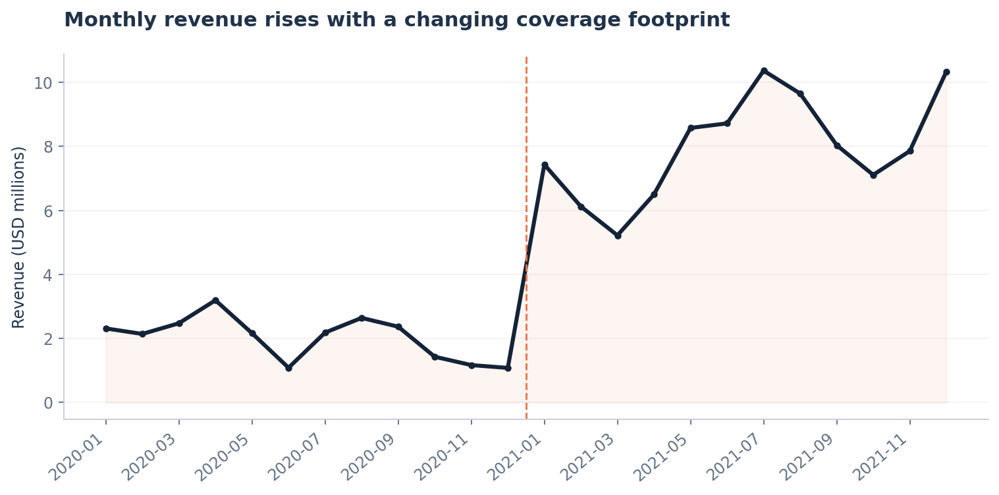
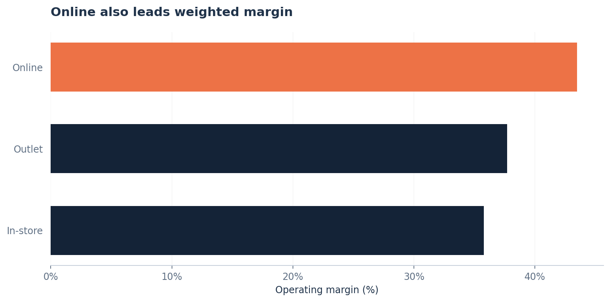

# Adidas US Sales — Business Performance Analysis

**Independent portfolio case study | Python · Pandas · Matplotlib · Business Intelligence**

A business-focused exploration of a public Kaggle sales dataset covering **2020–2021**. The analysis examines retailer performance, revenue patterns, geography, product mix, sales channels, holiday windows, and operational profitability. Analytical decisions and interpretations are those of the project author; this is **not an official Adidas report**.

## At a glance

| KPI | Audited result |
|---|---:|
| Records / time period | 9,648 / 2020–2021 |
| Total units sold | 2,478,861 |
| **Recomputed** revenue | **$120.17M** |
| **Recomputed** operating profit | **$47.22M** |
| Revenue-weighted operating margin | 39.30% |
| Retail partners / US states | 6 / 50 |

> **Crucial accounting caveat.** The source's reported revenue sums to **$899.90M**, whereas **3,886 of 9,648 records** show revenue exactly ten times `price_per_unit × units_sold`. This project adopts the explicit, reproducible **recomputed-sales convention**, obtaining **$120.17M**, and recomputes operating profit as the resulting revenue multiplied by the supplied margin. The two definitions **must not be mixed**. The spreadsheet's scaling discrepancy cannot be resolved conclusively using the available fields, so these figures are an analytical scenario, not independently validated Adidas financial statements.

## Project overview and business objectives

Understand which retailers, regions, products and sales channels contribute to observed volume, modeled revenue and margin. Explore temporal patterns without making unjustified like-for-like year comparisons, and translate descriptive observations into *testable* operational decisions.

## Dataset description and source

- **Kaggle:** [Adidas Sales Dataset by heemalichaudhari](https://www.kaggle.com/datasets/heemalichaudhari/adidas-sales-dataset); original workbook named `Adidas US Sales Datasets.xlsx`, sheet `ADIdata_RAW`.
- Grain: recorded sales *row* (not a validated distinct order, customer, or invoice).
- Fields: retailer, retailer ID, invoice date, region/state/city, product, unit price, units, original sales, reported operating profit, operating margin and sales method.
- 9,648 usable source rows; 724 observed transaction dates; 6 retailers; 50 states; 6 product labels; 3 sales methods.
- Source file **not redistributed**. The Kaggle dataset page's redistribution license/terms have **not been independently confirmed**; obtain the workbook at the source and check its terms before republishing.

## Tools and technologies

Python 3.11+, Pandas, NumPy, Matplotlib, Jupyter, Excel input via `openpyxl`. Optional supplementary SQL is supplied for PostgreSQL but was **not database-executed** in this audit.

## Data preparation and methodology

1. Read `ADIdata_RAW` from row 5 (columns B:N) and normalize field names and text.
2. Convert dates, numeric columns and mandatory fields; inspect blanks and duplicates. Original audit: **0 rejected rows, 0 complete duplicates** and **4 rows with zero units** (retained).
3. Recompute `total_sales = price_per_unit × units_sold`, and `operating_profit = total_sales × operating_margin`. **3,886 raw revenue cells disagree by a factor of 10.** This is a modeling choice, **not a verified correction to Adidas reporting**.
4. Derive year/month, weekday/weekend, season, product gender label and product category. `Men's`/`Women's` describe *product targeting*, not customer demographics.
5. Aggregate by relevant business segment. Weighted margin is `SUM(profit) / SUM(revenue) × 100`, **not** the average of row margins.

## Key performance indicators

| KPI | Formula | Interpretation |
|---|---|---|
| Units sold | `SUM(units_sold)` | Merchandise volume |
| Modeled revenue | `SUM(price_per_unit × units_sold)` | Sales under the explicit normalization |
| Modeled operating profit | `SUM(modeled_revenue × operating_margin)` | Scenario profit based on source margins |
| Operating margin | `SUM(modeled_profit) / SUM(modeled_revenue)` | Revenue-weighted profitability |
| Realized price/unit | `SUM(modeled_revenue) / SUM(units_sold)` | Unit-weighted realized selling value |
| Segment share | `segment total / overall total` | Relative contribution, within the observed sample |

## Analysis areas and verified findings

| Area | Evidence | Business interpretation |
|---|---|---|
| **Retail partners** | West Gear leads modeled revenue (**$32.41M**); Sports Direct has the highest weighted retailer margin (**43.23%**). | Revenue leaders and profitability leaders differ. |
| **Time** | 2021 revenue **$95.93M** versus **$24.24M** in 2020; state coverage expands from **9** to **46**. | Do **not** label the aggregate difference organic growth. |
| **Geography** | West revenue **$36.44M**, whereas South margin **44.76%**. | Optimize by regional mix, not topline alone. |
| **Products** | Men's Street Footwear revenue **$27.68M**. | Examine assortment drivers within the observed product categories. |
| **Sales channels** | Online revenue **$44.97M** and operating margin **43.48%**. | Validate channel economics before shifting budget. |
| **Holiday windows** | Descriptive ±3-day comparisons to nearby reference dates are implemented. | Overlapping windows, changing coverage and absence of causal controls prevent promotional-lift claims. |
| **Economics** | Overall weighted margin **39.30%**, modeled profit **$47.22M**. | Margin and scale should be evaluated jointly. |

## Visualizations





Charts are generated using the same normalized dataset as the main notebook and management presentation.

## Conclusions and business recommendations

The primary finding is a **trade-off between commercial scale and modeled margin**, not an unconditional growth story. Prioritize (1) a source-system reconciliation of the tenfold sales discrepancy, (2) like-for-like geographic and retailer comparisons, and (3) validation of potential channel/assortment pilots using cost and demand information unavailable in the sample. These are *recommendations for further investigation*, not causal conclusions.

## Project structure

```text
.
├── README.md
├── requirements.txt
├── .gitignore
├── data/README.md                      # dataset retrieval, no bundled workbook
├── notebooks/
│   ├── Adidas_Business_Performance.ipynb  # end-to-end English case study
│   └── deep_dives/                    # seven supplementary authored explorations
├── docs/
│   ├── data_dictionary.md
│   └── *.png                          # case-study figures
└── sql/Adidas_Analytical_Queries.sql  # optional; not database-executed
```

## How to run

1. Download the workbook from [Kaggle](https://www.kaggle.com/datasets/heemalichaudhari/adidas-sales-dataset) and save it as `data/Adidas US Sales Datasets.xlsx`.
2. Create an isolated Python environment and install the dependencies: `pip install -r requirements.txt`.
3. Open `notebooks/Adidas_Business_Performance.ipynb` and use **Run All**. It locates the local `data/` workbook or a Kaggle attached dataset under `/kaggle/input/`. It calculates everything **in memory** and produces charts below each area.
4. Supplementary deep-dive notebooks represent the original more granular analytical exploration; these expect `output/adidas_sales_features.csv` as produced by the original two-stage preparation. This intermediate CSV is intentionally not shipped. For reproducing them, use `notebooks/deep_dives/01_data_cleaning.ipynb` then `02_feature_engineering.ipynb` from the project root; these write intermediate files to `output/`.
5. On Kaggle, create a new notebook, attach the dataset and import the notebook from `kaggle/` in the project release. Do **not** upload the source Excel separately unless its license permits that action.

## Data limitations

- The 3,886 tenfold discrepancies materially change headline KPIs; upstream ground truth is **not confirmed**.
- The source is a third-party dataset, not a certified or representative census of Adidas US financials.
- Dates/retailers/states are unevenly represented (2020: 9 states; 2021: 46 states); year-on-year deltas lack a stable population.
- Transactions, unique orders, customers, returns, discounts, actual expense detail, inventory and exposure are not identifiable.
- Operating margin originates from the source; modeled profit is not an independently audited profit measure.
- Product gender labeling is a taxonomy only. Holidays are overlapping descriptive windows with no causal identification.
- Supplemental PostgreSQL queries are **reference SQL**; execution against a database is not confirmed.

---

*Independent analysis and data storytelling. Adidas is a trademark of its respective owner; no endorsement implied.*
